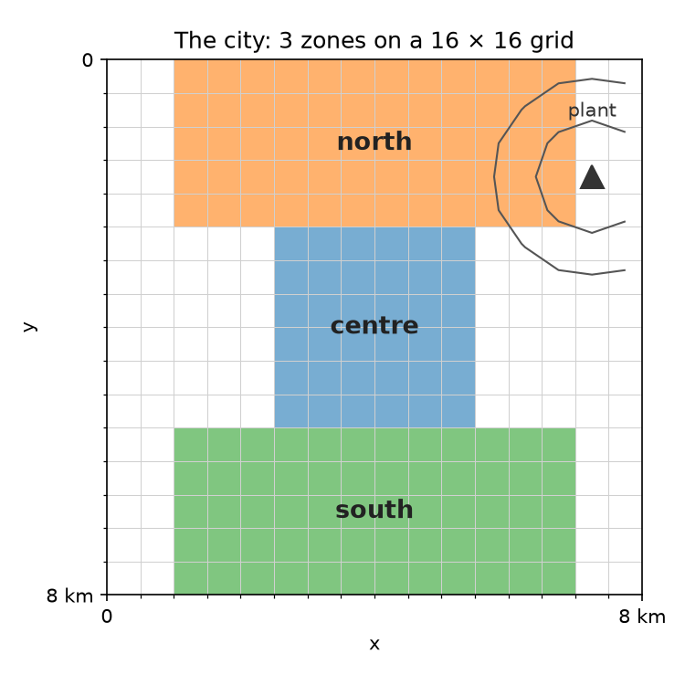
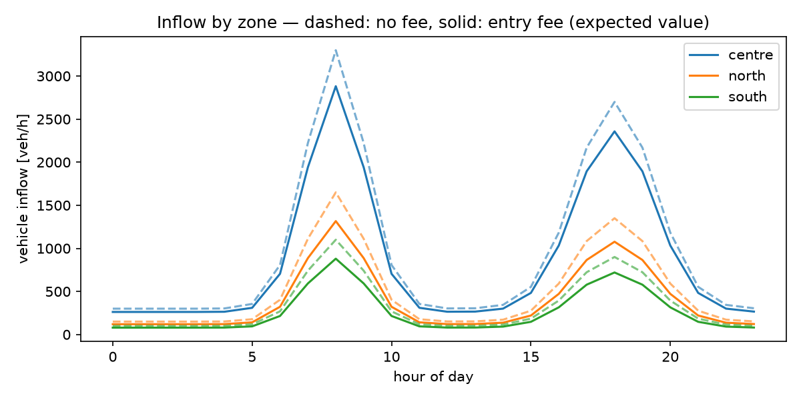
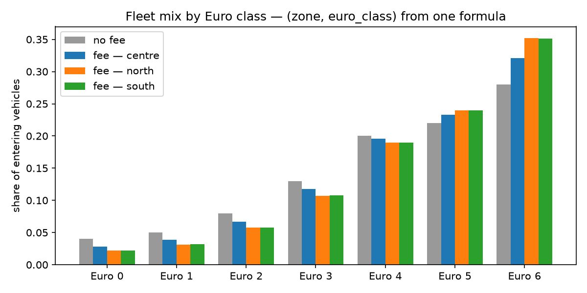
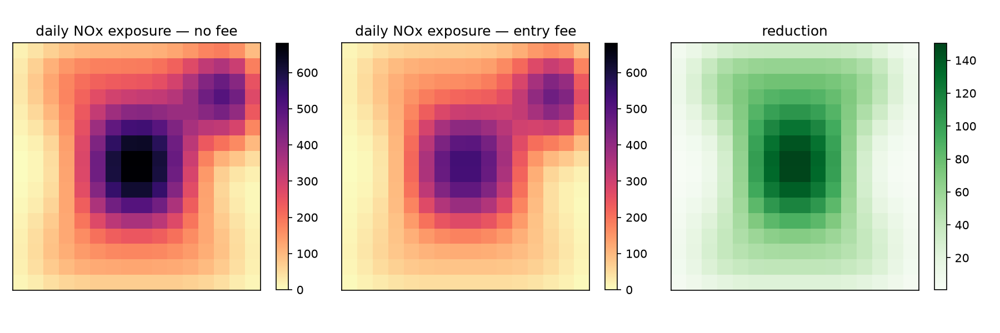
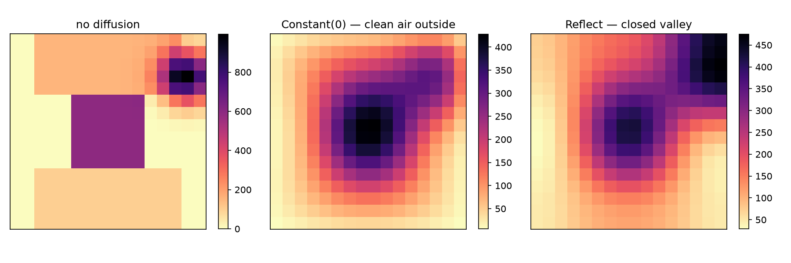

<!-- _class: lead -->
<!-- _paginate: false -->

# Civic Digital Twins
## Axes in CDT v0.12.0

*Multi-domain models · Typed axes · Reading results by name*

<br>

**Marco Pistore** · MOST · Fondazione Bruno Kessler
**Claude Opus 5.5** · Anthropic

---

<!-- _class: dense -->
<!-- _footer: "Introduction" -->

## What this seminar covers

Until v0.11, a CDT model had **one** domain dimension, besides the parameter and ensemble axes: time. Every other dimension — zones, vehicle classes, grid cells — had to become a Python list of indexes, or a hand-written loop.

**CDT v0.12.0 makes time one domain axis among many.** An index can carry any number of named, typed axes; formulas combine them, reductions name them, results report them.

| | Part | Topics |
|---|---|---|
| **0** | Running example | A city, three zones, a grid |
| **1** | Defining axes | `DomainAxis`, type lattice, identity, roles |
| **2** | Indexes with a shape | `axes=`, `FIXED_AXES`, contract check, shaped distributions |
| **3** | Computing along axes | Reductions, outer products, ordered & spatial operators, `broadcast`, registered functions |
| **4** | Reading results | `layout_of`, `labeled`, the ordering trap, results |
| **5** | `@config` | `Config` vs `Inputs`, `default_config()` |
| **6** | Wrap-up | Summary, migration checklist, roadmap |

Companion code: `docs/axis-seminar/seminar_axes.py` on branch `docs/axis-seminar` — the model, the outputs and the figures in these slides come from it.

---

<!-- _class: section-header -->

# Part 0 — Running Example
## City air quality under an entry fee

---

<!-- _class: dense -->
<!-- _footer: "Part 0 — Running Example" -->

## A city, three zones, a grid

<div class="columns">
<div>

**Setting:** a city split into three zones — *centre*, *north*, *south* — on a 16 × 16 grid of 0.5 km cells. An industrial plant sits in the north-east.

**Policy:** an entry fee graduated by Euro class (Euro 0 pays 6 €, Euro 6 pays nothing).

**Question:** how do inflow, NOx emissions and **NOx exposure across the city** change?

| Axis | Type | Size |
|------|------|------|
| `zone` | set | 3 |
| `euro_class` | sequence | 7 |
| `time` | time | 24 h |
| `x`, `y` | space | 16 × 16 |

Uncertain: the price threshold, drawn **independently per zone**.

</div>
<div>



</div>
</div>

---

<!-- _class: dense -->
<!-- _footer: "Part 0 — Running Example" -->

## How we will model it

```
  inflow (zone, time)            fleet mix · emission factor · fee (euro_class)
  price threshold (zone) ~ uncertain                  │
                │                                     │
                ▼                                     ▼
     ┌──────────────────────────────────────────────────────┐
     │ TrafficModel — how many vehicles still enter,        │
     │                and how much NOx they emit            │
     └──────────────────────────┬───────────────────────────┘
         emissions (zone, time) │
                                ▼
     ┌──────────────────────────────────────────────────────┐
     │ spread each zone's emissions over its cells          │ ◄── zone map (zone, y, x)
     └──────────────────────────┬───────────────────────────┘
                                │          plant emissions (y, x) × activity (time)
   traffic source (time, y, x)  │                              │ industry source (time, y, x)
                                ▼                              ▼
     ┌────────────────────────────────────┐   ┌──────────────────────────────────┐
     │ DispersionModel — traffic          │   │ DispersionModel — industry       │
     │ diffuse over the grid              │   │ diffuse over the grid            │
     └─────────────────┬──────────────────┘   └────────────────┬─────────────────┘
                       └───────────────────+───────────────────┘
                                           │ concentration (time, y, x)
                                           ▼
                                   daily exposure (y, x)
```

Each arrow carries a quantity **and its axes**: the dimensions change along the pipeline — `(zone, time)` → `(time, y, x)` → `(y, x)`. Both `DispersionModel`s also take `diffusivity` and `persistence` (scalars). `CityAirModel` is the root model that wires the three sub-models.

---

<!-- _footer: "Part 0 — Running Example" -->

## Why time alone is not enough

**Without domain axes**, a second dimension becomes a list of indexes, and every formula over it is unrolled by hand (from `examples/mobility_bologna`):

```python
i_p_cost: list[Index]                     # one Index per Euro class
...
Index("average cost",
      inputs.i_p_cost[0] * euro_class_split["euro_0"]
    + inputs.i_p_cost[1] * euro_class_split["euro_1"]
    + ...                                   # seven terms
    + inputs.i_p_cost[6] * euro_class_split["euro_6"])
```

**With domain axes**, the dimension is part of the index — the same computation:

```python
i_p_cost: EuroIndex                       # one Index, 7 values (euro_class_split is one too)
...
Index("average cost", (inputs.i_p_cost * euro_class_split).sum(axis=EURO))
```

The formula no longer depends on how many Euro classes there are.

---

<!-- _class: section-header -->

# Part 1 — Defining Axes

*Roles · DomainAxis · Type lattice · Identity*

---

<!-- _class: dense -->
<!-- _footer: "Part 1 — Defining Axes" -->

## Axes and their roles

An **axis** names one dimension of a value. Every axis has a **name** and a **role**; the role says where the dimension comes from:

| Role | Comes from | In the running example |
|------|------------|------------------------|
| `DOMAIN` | what you **declare** — the dimensions of the problem | `zone`, `euro_class`, `time`, `x`, `y` |
| `PARAMETER` | what you **sweep** — one axis per swept input | `trip length`, swept over 2, 3, 4 km |
| `ENSEMBLE` | what is **uncertain** — one entry per draw | `_ensemble`, 100 draws of the price threshold |

<div class="columns">
<div>

```python
trip_length = Index("trip length")    # no value: swept
sweep = Scenario(swept, parameter_axes=[trip_length])
res_sweep = Evaluation(sweep).evaluate(
    ensemble=DistributionEnsemble(sweep, size=ENSEMBLE_SIZE, ...),
    parameters={trip_length: np.array([2.0, 3.0, 4.0])},
)
```

</div>
<div>

| `res_sweep.layout` | role | size |
|------|------|------|
| `euro_class`, `time`, `x`, `y`, `zone` | DOMAIN | 7, 24, 16, 16, 3 |
| `trip length` | PARAMETER | 3 |
| `_ensemble` | ENSEMBLE | 100 |

</div>
</div>

Every result is laid out as `( *PARAMETER, *ENSEMBLE, *DOMAIN )`. You only ever create the DOMAIN axes; the others come from the scenario and the ensemble.

---

<!-- _footer: "Part 1 — Defining Axes" -->

## `DomainAxis` and its type

A `DomainAxis` adds a **type** that says what kind of dimension it is:

```python
ZONE = DomainAxis("zone", type=SetType())
EURO = DomainAxis("euro_class", type=SequenceType())
X = DomainAxis("x", type=SpaceType(spacing=0.5, boundary=Constant(0.0)))
Y = DomainAxis("y", type=SpaceType(spacing=0.5, boundary=Constant(0.0)))
# TIME_AXIS is ready-made: DomainAxis("time", type=TimeType())
```

The types form a lattice — each one unlocks more operators:

| Type | Meaning | Unlocks |
|------|---------|---------|
| `SetType` | unordered labels | reductions (`sum`, `mean`, `max`, …) |
| `SequenceType` | ordered positions | + `shift`, `roll`, `diff`, `cumulative` |
| `TimeType` | ordered in time | (as `SequenceType`) |
| `SpaceType(spacing, boundary)` | a physical grid | + `gradient`, `laplacian` |

---

<!-- _class: dense technical -->
<!-- _footer: "Part 1 — Defining Axes" -->

## Identity is `(name, role)` — define each axis once

The type is **metadata**: two axes with the same name and role are the **same axis**, whatever their type.

```python
plain_x = Axis("x", DOMAIN)     # same name and role as X, but no type
plain_x == X                    # True
```

So wherever axes are matched — combining operands, checking contracts, laying out results — `plain_x` and `X` count as one axis. Combining them gives one `x` axis, not an outer product. But the result keeps **one** of the two, and it may be the untyped one:

```python
u    = Index("u", np.arange(4), axes=(X,))
ones = Index("ones", np.ones(4), axes=(plain_x,))

(u * ones).output_axes   # (DomainAxis('x', type=SpaceType(...)),)
(ones * u).output_axes   # (Axis('x', role='DOMAIN'),)          ← type lost
```

Operators read the type **from the axis object they get**: a `laplacian` over the `x` taken from `ones * u` fails with `gradient/laplacian require a SpaceType axis`.

**Rule:** define every axis **once**, in one module (an `axes.py`), and always import that object.

---

<!-- _class: section-header -->

# Part 2 — Indexes with a Shape

*axes= on values and formulas · Named shapes · Contract check · Shaped distributions*

---

<!-- _footer: "Part 2 — Indexes with a Shape" -->

## Values: `axes=` declares the shape

When an index holds an array, `axes=` names its dimensions — matched to the array's shape **by position**:

```python
Index("inflow", INFLOW, axes=(ZONE, TIME_AXIS))    # INFLOW.shape == (3, 24)
# sizes {'zone': 3, 'time': 24}
```

The order is load-bearing, and only the rank is checked:

```python
Index("inflow", INFLOW.T, axes=(ZONE, TIME_AXIS))  # transposed by mistake
# sizes {'zone': 24, 'time': 3}   ← accepted silently!
```

An array without `axes=` has **no** axes — in v0.12.0 it fails later, at evaluation (`unexpected ndim`); v0.13.0 catches it when the index is defined.

---

<!-- _footer: "Part 2 — Indexes with a Shape" -->

## Formulas: axes are inferred — `axes=` only checks them

**Inference.** A formula's axes follow from its operands — you never declare them:

```
inflow * 2                                 -> inferred axes ('zone', 'time')
inflow.sum(axis=ZONE)                      -> inferred axes ('time',)
inflow.sum(axis=ZONE).sum(axis=TIME_AXIS)  -> inferred axes ()
```

**Verification.** `axes=` on a formula states what you *expect*; it is compared (as a set) with what was inferred, and never changes it:

```python
Index("total inflow", inflow.sum(axis=ZONE), axes=(TIME_AXIS,))         # ok
Index("total inflow", inflow.sum(axis=ZONE), axes=(ZONE, TIME_AXIS))
# ValueError: declared axes (zone, time) do not match the actual output_axes (time,).
#   Declaring axes verifies the shape, it cannot relabel it.
```

How operands combine — shared axes, outer products — is the subject of Part 3.

---

<!-- _footer: "Part 2 — Indexes with a Shape" -->

## Named shapes: `FIXED_AXES`

Writing `axes=(ZONE, TIME_AXIS)` at every index is noisy, and says nothing in a type annotation. `TimeseriesIndex` solves this for time: it is an `Index` whose axes are fixed to `(TIME_AXIS,)`. The same recipe gives any shape a name:

```python
class ZoneTimeIndex(Index):
    FIXED_AXES = (ZONE, TIME_AXIS)

    def __init__(self, name, value=None):
        super().__init__(name, value, axes=self.FIXED_AXES)
```

One class, three uses:

```python
inflow = ZoneTimeIndex("inflow", INFLOW)                           # a value: axes declared
modified = ZoneTimeIndex("modified inflow", i.inflow * kept)       # a formula: axes checked

class Inputs:
    inflow: ZoneTimeIndex                                          # a contract: checked at construction
```

The running example declares six shapes this way — next slide.

---

<!-- _class: dense -->
<!-- _footer: "Part 2 — Indexes with a Shape" -->

## The shapes in the running example

| Shape class | Axes | Indexes |
|-------------|------|---------|
| **Built in** | | |
| `Index` | `()` | `trip_length`, `diffusivity`, `persistence`, `total_emissions` |
| `TimeseriesIndex` | `(time,)` | `industry_activity`, `hourly_emissions`, `cumulative_emissions` |
| **Declared** (like `ZoneTimeIndex`) | | |
| `ZoneIndex` | `(zone,)` | `cost_threshold` *(uncertain)*, `kept fraction`, `average emission factor` |
| `EuroIndex` | `(euro_class,)` | `fleet_split`, `emission_factor`, `entry_fee` |
| `MapIndex` | `(y, x)` | `industry`, `exposure` |
| `ZoneTimeIndex` | `(zone, time)` | `inflow`, `modified_inflow`, `emissions` |
| `ZoneMapIndex` | `(zone, y, x)` | `zone_map` |
| `FieldIndex` | `(time, y, x)` | `traffic source`, `industry source`, `concentration` |
| **No named shape** | | |
| `Index` + `axes=` | `(zone, euro_class)` | `rigid fraction`, `modified_split` |

- `(zone, euro_class)` is only used inside `TrafficModel`: a plain `Index` with `axes=` is enough there.

---

<!-- _footer: "Part 2 — Indexes with a Shape" -->

## The contract check is structural

Annotate an `Inputs` / `Outputs` / `Expose` field with a `FIXED_AXES` class, and the actual value's axes are **checked at construction**:

```python
@define("Dispersion")
class DispersionModel(Model):
    @inputs
    class Inputs:
        source: FieldIndex  # g/h per cell, (time, y, x)
        ...

DispersionModel(inputs=DispersionModel.Inputs(source=industry, ...))   # industry: (y, x)
# ValueError: Inputs.source: declared axes (time, y, x) do not match the actual output_axes (y, x)
```

The check compares **axes**, never classes: any value with axes `(time, y, x)` satisfies `FieldIndex` — a formula wrapped in `Index`, a `FieldIndex`, or a class from another package. Components written by different teams interoperate around a shape without sharing a class hierarchy.

A plain `Index` annotation stays unchecked.

---

<!-- _class: dense -->
<!-- _footer: "Part 2 — Indexes with a Shape" -->

## Shaped `DistributionIndex`

`DistributionIndex` accepts `axes=` / `shape=` (given together) — a grid of **independent** draws, every cell resampled per ensemble member. As a named shape, it is the uncertain variant of `ZoneIndex`:

```python
# The uncertain variant of a shape: DistributionIndex first, so it wins construction
# (the same recipe as ConstTimeseriesIndex = ConstIndex + TimeseriesIndex).
class DistributionZoneIndex(DistributionIndex, ZoneIndex):
    def __init__(self, name: str, distribution: Callable[..., Any], params: dict[str, Any], *, shape: tuple[int, ...]):
        super().__init__(name, distribution, params, axes=self.FIXED_AXES, shape=shape)


# Price-elasticity threshold: drivers in the centre are less sensitive to price.
cost_threshold = DistributionZoneIndex(
    "price threshold",
    stats.uniform,
    {"loc": np.array([6.0, 3.0, 3.0]), "scale": np.array([6.0, 5.0, 5.0])},
    shape=(3,),  # Note: len(ZONES) = 3
)
```

- One draw **per zone** per scenario — the zones are not perfectly correlated.
- Parameters can differ per cell (here: per-zone `loc` / `scale`).
- Works with `DistributionEnsemble`, `PartitionedEnsemble`, and the non-conditional branch of `CrossProductEnsemble`.

Everything downstream inherits the `zone` axis — and the uncertainty.

---

<!-- _class: section-header -->

# Part 3 — Computing Along Axes

*Reductions · Outer products · Ordered & spatial operators · broadcast · Registered functions*

---

<!-- _class: dense -->
<!-- _footer: "Part 3 — Computing Along Axes" -->

## Formulas combine axes; reductions name them

```python
def compute(self, inputs: Inputs) -> tuple[Outputs, Expose]:
    i = inputs
    # (euro_class,) / (zone,) -> (zone, euro_class): an intended outer product.
    rigid = Index(
        "rigid fraction",
        graph.exp(-(i.entry_fee / i.cost_threshold) * LN2),
        axes=(ZONE, EURO),
    )
    kept = ZoneIndex("kept fraction", (i.fleet_split * rigid).sum(axis=EURO))
    modified_split = Index("modified split", i.fleet_split * rigid / kept, axes=(ZONE, EURO))
    modified_inflow = ZoneTimeIndex("modified inflow", i.inflow * kept)
    avg_factor = ZoneIndex("average emission factor", (i.emission_factor * modified_split).sum(axis=EURO))
    emissions = ZoneTimeIndex("emissions", modified_inflow * avg_factor * i.trip_length)
    hourly = TimeseriesIndex("hourly emissions", emissions.sum(axis=ZONE))
    total = Index("total emissions", hourly.sum())  # one DOMAIN axis left: axis= may be omitted
```

With two or more DOMAIN axes, `axis=` is **required**:

```
emissions.sum()   →  ValueError: ZoneTimeIndex needs an explicit axis=: this index carries
                     2 DOMAIN axes ['zone', 'time'], so there is no unique default axis.
```

---

<!-- _footer: "Part 3 — Computing Along Axes" -->

## How axes combine — and when CDT warns

A formula's axes are the **union** of its operands' axes; NumPy broadcasting aligns them by name.

| Operands | Result | |
|----------|--------|---|
| `(zone, time) * (zone,)` | `(zone, time)` | shared axis — fine |
| `(zone, time) * ()` | `(zone, time)` | scalar — fine |
| `(euro_class,) / (zone,)` | `(euro_class, zone)` | **disjoint** → outer product |

An outer product is often a mistake, so CDT warns unless you declare it:

```python
Index("fee ratio (undeclared)", fee / thr)
# AxesInferenceWarning: inferred output_axes=(euro_class, zone) — combining operands
#   with disjoint axes produced a result broader than any single operand.

Index("fee ratio (declared)", fee / thr, axes=(ZONE, EURO))   # no warning
```

⚠️ The check looks only at the **outermost** operation: `exp(fee / thr)` is not flagged. We will fix it!

---

<!-- _footer: "Part 3 — Computing Along Axes" -->

## From zones to the grid

The **zone map** `(zone, y, x)` holds each zone's share of every cell (summing to 1 per zone). A product with a shared axis followed by a reduction moves data from one domain to another:

```python
# (zone, time) * (zone, y, x), summed over zone -> (time, y, x)
traffic_source = FieldIndex("traffic source", (traffic.outputs.emissions * i.zone_map).sum(axis=ZONE))
```

An **intended** outer product, declared by the target class:

```python
# (y, x) * (time,) -> (time, y, x): an intended outer product, declared by FieldIndex.
industry_source = FieldIndex("industry source", i.industry * i.industry_activity)
```

The same pattern covers zone ↔ census section, road link ↔ zone, OD matrices: a mapping index with **both** axes, a product, a `sum(axis=...)`.

---

<!-- _footer: "Part 3 — Computing Along Axes" -->

## Ordered axes: `shift`, `roll`, `diff`, `cumulative`

Available on any `SequenceType` axis — `time`, `euro_class`, …

| Method | Result |
|--------|--------|
| `x.shift(n, axis=A, fill_value=0.0)` | moves values by `n` positions, fills the gap |
| `x.roll(n, axis=A)` | circular shift |
| `x.diff(n, axis=A)` | `x - x.shift(n)` — per *sample*, ignores spacing |
| `x.cumulative(axis=A)` | running sum |

From the model — part of the previous hour's pollution is still in the air, and the emissions add up over the day:

```python
c = FieldIndex("lingering source", inputs.source + inputs.persistence * inputs.source.shift(1, axis=TIME_AXIS))

cumulative = TimeseriesIndex("cumulative emissions", hourly.cumulative(axis=TIME_AXIS))
```

---

<!-- _class: dense -->
<!-- _footer: "Part 3 — Computing Along Axes" -->

## Spatial axes: `gradient`, `laplacian`, boundaries

On `SpaceType` axes: `gradient(axis=X)` is the derivative per unit *distance* along one axis; `laplacian(axes=(X, Y))` sums the second derivatives. Explicit diffusion is a loop over `laplacian`:

```python
for step in range(config.diffusion_steps):
    c = FieldIndex(f"diffusion step {step + 1}", c + inputs.diffusivity * c.laplacian(axes=(x, y)))
```

The **boundary** — what lies beyond the edge of the grid — is part of the axis type:

| Boundary | Meaning |
|----------|---------|
| `Constant(v)` (alias `Dirichlet`) | fixed value at the border — `Constant(0.0)`: clean air outside |
| `Neumann(v)` / `Reflect` (default) | fixed derivative — `Reflect = Neumann(0)`: no flux, a closed valley |
| `Nearest()` | repeat the outermost cell |
| `Wrap()` | periodic: opposite borders connect |
| `Linear()` | extend the local linear trend |

Boundaries only change the two end values of each row.

---

<!-- _footer: "Part 3 — Computing Along Axes" -->

## `.broadcast()` — an axis nothing provides

`axes=` cannot add an axis that the formula never references:

```python
FieldIndex("industry source", industry)                       # industry: (y, x)
# ValueError: declared axes (time, y, x) do not match the actual output_axes (y, x)

FieldIndex("industry source", industry.broadcast(TIME_AXIS))  # → axes (y, x, time)
```

⚠️ **`broadcast` promises the axis at size 1 — it does not repeat the data.** A later reduction sees size 1:

```
peak cell 40 g/h, summed over the day:
  industry.broadcast(TIME).sum(axis=TIME)  -> 40     (size 1: counted once)
  (industry * ones(24)).sum(axis=TIME)     -> 960
```

Use it to satisfy a shape contract where the value *really* is constant along the axis and will be combined with something that has the real extent. If you need the data along the axis, multiply by a profile — as `industry * industry_activity` does.

---

<!-- _class: dense technical -->
<!-- _footer: "Part 3 — Computing Along Axes" -->

## Registered functions see positions, not names

A *registered function* is plain NumPy code plugged into the graph: `graph.function_call("peak", inflow)` in the model, `functions={"peak": NumpyBackend.adapt(peak)}` at evaluation.

The function gets a **bare array**: no axis names, dimensions **sorted by axis name**. `inflow` is declared `(zone, time)`, but arrives as `(time, zone)`:

```python
def peak_by_last_axis(values: np.ndarray) -> np.ndarray:
    return np.max(values, axis=-1, keepdims=True)   # assumes time is the LAST dimension
```

| | per-zone peak inflow [veh/h] |
|---|---|
| expected: max over **time**, per zone | `[3300, 1650, 1100]` — what `inflow.max(axis=TIME_AXIS)` gives |
| `peak_by_last_axis`: max over **zones**, per hour | `[300, 300, 300, …]` — 24 values, no error |

- Prefer **named graph operators** (`inflow.max(axis=TIME_AXIS)`) whenever one exists.
- Otherwise **declare the signature**: wrong arguments are rejected when the model is built — but the array is not reordered.

```python
signed_peak = NumpyBackend.adapt(peak_by_last_axis, output_axes=(ZONE,), input_axes=((ZONE, TIME_AXIS),))
graph.function_call("peak", inflow, functor=signed_peak)
```

---

<!-- _class: section-header -->

# Part 4 — Reading Results

*layout · layout_of · labeled · The ordering trap*

---

<!-- _footer: "Part 4 — Reading Results" -->

## `result.layout` vs `result.layout_of(index)`

```python
policy = Scenario(model)
baseline = Scenario(model, overrides={model.inputs.entry_fee: np.zeros(N_EURO)})
res = Evaluation(policy).evaluate(
    ensemble=DistributionEnsemble(policy, size=ENSEMBLE_SIZE, rng=np.random.default_rng(42))
)
```

<div class="columns">
<div>

**`res.layout`** — the union over the whole evaluation (raw arrays):

| axis | role | size |
|------|------|------|
| `_ensemble` | ENSEMBLE | 100 |
| `euro_class` | DOMAIN | 7 |
| `time` | DOMAIN | 24 |
| `x` | DOMAIN | 16 |
| `y` | DOMAIN | 16 |
| `zone` | DOMAIN | 3 |

</div>
<div>

**`res.layout_of(idx)`** — the axes of *one* output, after the ensemble is averaged out (`expected_value(idx)`).

No output carries all six axes: `exposure` has `(x, y)`, `total_emissions` has none.

With several DOMAIN axes, **position alone no longer identifies a dimension** — `layout_of` is how you find out which is which.

Overrides for a domain-carrying index are plain arrays of the declared rank.

</div>
</div>

---

<!-- _footer: "Part 4 — Reading Results" -->

## The ordering trap

Inside `( *PARAMETER, *ENSEMBLE, *DOMAIN )`, DOMAIN axes come back **sorted by name** — not in the order you declared:

| Output | Declared | Returned (`labeled(idx).dims`) |
|--------|----------|--------------------------------|
| `modified_inflow` | `(zone, time)` | `(time, zone)` |
| `emissions` | `(zone, time)` | `(time, zone)` |
| `concentration` | `(time, y, x)` | `(time, x, y)` |
| `exposure` | `(y, x)` | `(x, y)` |
| `cumulative_emissions` | `(time,)` | `(time,)` |

```python
raw = np.asarray(res.expected_value(model.outputs.modified_inflow))
raw.shape    # (24, 3) — declared (zone, time)!
raw[0]       # [262. 120.  80.] — hour 0 for every zone, not the centre's day
```

Why by name: an order derived from the formula would depend on how it was written (`a * b` vs `b * a`). The price: code that reads results **by position** is correct only as long as the axis names sort the way it assumes — renaming or adding an axis silently changes the meaning of `raw[0]`.

---

<!-- _footer: "Part 4 — Reading Results" -->

## Read by name: `labeled()` and `.sel()`

`res.labeled(idx)` pairs `expected_value(idx)` with `layout_of(idx)`:

```python
inflow_lab = res.labeled(model.outputs.modified_inflow)
inflow_lab.dims                          # ('time', 'zone')

centre = inflow_lab.sel(zone=ZONES.index("centre"))
centre.dims                              # ('time',) — peak 2882 veh/h

inflow_lab.sel(time=slice(7, 10)).dims   # ('time', 'zone') — a slice keeps the axis

# a plain array in the order YOU need (e.g. rows = zones for a plot),
# built from the names — correct whatever order the result came in
np.transpose(inflow_lab.values, [inflow_lab.dims.index(n) for n in ("zone", "time")])

inflow_lab.to_xarray()                   # optional: needs xarray installed
```

- `.sel()` takes **positions** (an `int` drops the axis, a `slice` keeps it), not labels.
- `labeled()` is an extra accessor: `result[idx]` and `expected_value(idx)` are unchanged and still return plain `np.ndarray`.

---

<!-- _footer: "Part 4 — Reading Results" -->

## Results: inflow by zone and fleet mix

<div class="columns">
<div>



**Inflow** — dashed: no fee, solid: entry fee (expected value over 100 draws). Read with `labeled(...)` and reordered to `(zone, time)` by name.

</div>
<div>



**Fleet mix** — `modified_split` is a single `(zone, euro_class)` index. The centre, less price-sensitive, shifts less towards Euro 6.

</div>
</div>

Total NOx: **38.6 → 28.0 kg/day** (5th–95th pct 25.9 – 29.9) — the per-zone thresholds propagate through the whole pipeline.

---

<!-- _footer: "Part 4 — Reading Results" -->

## Results: exposure across the city



Daily NOx exposure without and with the fee, and the reduction — largest in the centre, where most vehicles enter. Peak exposure **681 → 530**.

`exposure` comes back as `(x, y)`: the maps are drawn after reordering to `(y, x)` by name.

---

<!-- _class: section-header -->

# Part 5 — Construction-time Config

*Construction-time choices that are not indexes*

---

<!-- _class: dense -->
<!-- _footer: "Part 5 — @config" -->

## `Config` vs `Inputs`

Some choices change the **structure** of the computation, not a value in it: how many diffusion steps to unroll, which boundary to use, which `ModelVariant` to select.

```python
@config
class Config:
    diffusion_steps: int = 6
    boundary: BoundaryCondition = Constant(0.0)

@classmethod
def default_config(cls) -> Config:
    return cls.Config(diffusion_steps=6, boundary=Constant(0.0))

def compute(self, inputs: Inputs, *, config: Config) -> Outputs:
    # Same axes (identity is (name, role)), with the boundary chosen by the config.
    x = DomainAxis("x", type=SpaceType(spacing=0.5, boundary=config.boundary))
    y = DomainAxis("y", type=SpaceType(spacing=0.5, boundary=config.boundary))
    ...
```

| | `Inputs` | `Config` |
|---|---|---|
| holds | indexes | plain data — never an `Index` |
| overridable per `Scenario`, sweepable | ✅ | ❌ — baked in at construction |
| e.g. | `diffusivity`, `entry_fee` | `diffusion_steps`, `boundary`, `time_shift_strategy` |

---

<!-- _footer: "Part 5 — @config" -->

## Same inputs, three configs

A root model nests its sub-models' configs:

```python
configs = {
    "no diffusion": CityAirModel.Config(dispersion=DispersionModel.Config(diffusion_steps=0)),
    "Constant(0) — clean air outside": CityAirModel.Config(
        dispersion=DispersionModel.Config(diffusion_steps=12, boundary=Constant(0.0))),
    "Reflect — closed valley": CityAirModel.Config(
        dispersion=DispersionModel.Config(diffusion_steps=12, boundary=Reflect)),
}
```



Checked at the model boundary: a wrong class raises `ConfigTypeMismatchError`; an `Index` inside a `Config` raises `TypeError: Config fields must not hold a GenericIndex; use Inputs instead`.

---

<!-- _class: section-header -->

# Part 6 — Wrap-up

*Summary · Migration · Roadmap*

---

<!-- _footer: "Part 6 — Wrap-up" -->

## Summary

| Concept | Mechanism | What it gives you |
|---------|-----------|-------------------|
| **Typed axis** | `DomainAxis(name, type=...)` | Set / sequence / time / space semantics |
| **Shaped index** | `Index(..., axes=)`, `FIXED_AXES` classes | Multi-dimensional quantities, one index each |
| **Contract check** | `FIXED_AXES` annotations | Wrong shapes rejected at construction, structurally |
| **Shaped uncertainty** | `DistributionIndex(axes=, shape=)` | Independent draws per zone / cell |
| **Named operators** | `sum(axis=)`, `shift`, `cumulative`, `laplacian`, … | Formulas independent of layout and sizes |
| **Explicit intent** | `axes=` on outer products, `.broadcast()` | Accidental outer products flagged |
| **Named results** | `layout_of()`, `labeled()`, `.sel()` | Robust to axis order |
| **`@config`** | `Config`, `default_config()` | Structural choices outside the graph |

---

<!-- _class: dense technical -->
<!-- _footer: "Part 6 — Wrap-up" -->

## Migration checklist (v0.11 → v0.12)

- **Reductions:** `.sum()` / `.mean()` / … need `axis=` as soon as an index carries two or more DOMAIN axes — or none.
- **Formula `axes=` is verified**, including the `(TIME_AXIS,)` that `TimeseriesIndex` fixes: a `TimeseriesIndex` around a formula without time now raises.
- **`FIXED_AXES` annotations are checked**: `TimeseriesIndex` / shape-class fields reject values with other axes.
- **`TimeseriesIndex` is an `Index`** (and `ConstTimeseriesIndex` a `ConstIndex`): review `isinstance` checks.
- **Removed:** `graph.timeseries_constant` / `timeseries_placeholder` → `array_constant` / `array_placeholder(axes=(TIME_AXIS,))`.
- **Hand-rolled functors** must declare `output_axes` / `input_axes` (set both to `None`).
- **`ModelVariant`**: `expose` is the field intersection across variants; `inputs` is a per-variant dict.
- **Reading results:** replace positional indexing on multi-axis outputs with `labeled(idx)` / `layout_of(idx)`.

---

<!-- _class: dense -->
<!-- _footer: "Part 6 — Wrap-up" -->

## Roadmap

**v0.12.0 (released)**
- ✅ Multi-domain axes, typed (`SetType` / `SequenceType` / `TimeType` / `SpaceType`)
- ✅ Shaped `Index` / `DistributionIndex`, `FIXED_AXES` contract check
- ✅ Ordered and spatial operators, boundary conditions, `.broadcast()`
- ✅ `layout_of`, `LabeledArray`, `@config`

**v0.13.0 (in progress on `dev`)**
- ✅ Optional `length` metadata on sequence-like axes — sizes checked during evaluation (#274)

**Under discussion** (from preparing this seminar)
- Named shapes: see next slide
- Twindex, a modelling language on top of CDT (see the slide after next)
- Registered functions that receive arrays in their *declared* axis order
- Outer-product warning on nested formulas; `labeled()` on broadcast outputs
- Labelled set axes (`SetType(labels=...)`) for `.sel(zone="centre")`

---

<!-- _class: dense -->
<!-- _footer: "Part 6 — Wrap-up" -->

## Named shapes: the mechanism needs tuning

What declaring shapes took in this seminar — and its rough edges:

```python
class ShapedIndex(Index): ...                                # a base class every project rewrites

class ZoneTimeIndex(ShapedIndex):                            # one class per shape
    FIXED_AXES = (ZONE, TIME_AXIS)

class DistributionZoneIndex(DistributionIndex, ZoneIndex):   # variants by multiple inheritance
    def __init__(self, name, distribution, params, *, shape):
        super().__init__(name, distribution, params, axes=self.FIXED_AXES, shape=shape)
```

- **Boilerplate in every project** — bdt-mobility has eight shape classes with the same `__init__`.
- **Variants by multiple inheritance** — base order matters; `__init__` must accept (and ignore) `axes=`.
- **Structural at runtime, nominal for Pyright** — `DistributionIndex(..., axes=(ZONE,))` passes a `ZoneIndex` field's check; Pyright rejects it.
- **`named_shape(prefix, axes)`** — a CDT factory for the three classes — works at runtime, but Pyright cannot use its results as annotations.
- **Declared order ≠ result order** — `FIXED_AXES = (ZONE, TIME_AXIS)` comes back as `(time, zone)`.

**Direction:** one-line, Pyright-visible shape classes: `class ZoneTimeIndex(Index, axes=(ZONE, TIME_AXIS))`.

---

<!-- _class: dense -->
<!-- _footer: "Part 6 — Wrap-up" -->

## The future: Twindex

```python
model RoutingCost:

    inputs:
        demand: Index

    config:
        policy: str = "shortest_path"

    outputs:
        cost: Index

    compute:
        if config.policy == "shortest_path":
            outputs.cost = inputs.demand * 2.0
        else:
            outputs.cost = inputs.demand * 1.0
        end
```

**Status:** a small declarative language that compiles `.twx` files to `@define` models like the ones in this seminar. Not released — on branch `feat/dsl`; syntax for axes still to come.

---

<!-- _class: dense -->
<!-- _footer: "Appendix — bdt-mobility" -->

## bdt-mobility: review notes

The repository already uses v0.12 axes (`ZONE_IN_AXIS`, `ZONE_PT_AXIS`, `ECL_AXIS`) and `@config`. Points to check:

- **Positional reads of results** — `plot.py` / `dashboard.py` index `expected_value(...)` by position (`values[list(zones)].sum(axis=0)`). Correct today only because `"internal zones"` sorts before `"time"`. `TimeseriesEclIndex` is declared `(time, euro class level)` but returned as `(euro class level, time)`. → `labeled(idx).sel(...)`.
- **`axis=-1` in registered functions** — `ts_solve` (`np.roll(..., axis=-1)`) and `_ts_sum` assume time is last; true only while `"time"` sorts after every other axis name. → named graph operators, or a declared `adapt(..., input_axes=, output_axes=)` signature.
- **`isinstance(index, ZoneInTimeseriesIndex)` dispatch** — misses any value with those axes built another way (e.g. a plain `Index` formula). → check `res.layout_of(idx)`.
- **Unweighted ensemble means** — `subs[index].mean(axis=0)` assumes the ensemble is the first dimension and equal weights. → `expected_value(idx)`.
- **Eight hand-written shape classes** with identical `__init__` → one shared base class (as in the companion script), or the one-line form once available.

---

<!-- _class: lead -->
<!-- _paginate: false -->

# Thank you

<br>

**Companion code** — `docs/axis-seminar/seminar_axes.py`

**Documentation** — `docs/design/dd-cdt-model.md` · `docs/design/dd-cdt-engine.md` · `CHANGELOG.md` (v0.12.0)

<br>

*Questions & discussion*
